# **Práctica 1.8 - Instalar Prestashop**
##### _Amparo Sánchez Ledo - ASIR 2 - 03/11/2026_

En esta práctica vamos a realizar la implantación de la aplicación web **[PrestaShop](https://prestashop.es/)** en una máquina virtual que vamos a levantar con **[Vagrant](https://developer.hashicorp.com/vagrant)**

> **[Vagrant](https://developer.hashicorp.com/vagrant)**: herramienta de software desarrollada por **HashiCorp** que permite _crear y gestionar entornos de desarrollo virtualizados_.

Antes, debemos saber acerca de la herramienta que vamos a utilizar:

**¿Qué es [Prestashop](https://es.wikipedia.org/wiki/PrestaShop)?**

- **Sistema Gestor de Contenidos (CMS)** de código abierto (open source) enfocado exclusivamente en el **comercio electrónico (e-commerce)**, es decir, en la creación y gestión de tiendas virtuales.

- Funciona sobre una arquitectura **[LAMP](https://aws.amazon.com/es/what-is/lamp-stack/)** (desarrollado en lenguaje **PHP** y respaldado por una base de datos **MySQL/MariaDB**)

- Dividido en **dos entornos principales**:

    - _Front-Office (Tienda pública)_: **Parte visible**, donde los clientes navegan por el catálogo, añaden productos y realizan compras.

    - _Back-Office (Panel de administración)_: **Panel privado** desde el que el administrador gestiona el inventario, precios, envíos, métodos de pago, clientes...

**Objetivo**: Automatizar mediante **scripts Bash** la instalación y configuración de una tienda online con **PrestaShop** (desde la línea de comandos **CLI**) sobre una **pila LAMP** en una máquina virtual con **Vagrant**. Debemos verificar previamente los requisitos y extensiones de **[PHP](https://www.php.net/)** con la herramienta **PhpPsInfo** y asegurando el acceso web mediante un **certificado SSL/HTTPS ([Let's Encrypt](https://letsencrypt.org/) / [Certbot](https://certbot.eff.org/))**.

---

## **_Índice de contenidos_**

0. **[Requisitos previos](#0-requisitos-previos)**

1. **[Preparación del entorno](#1-preparación-del-entorno)**

2. **[Scripts de aprovisionamiento automáticos](#2-scripts-de-aprovisionamiento)**

    - 2.1. [Instalación de la pila LAMP y PHP](#21-instalación-de-la-pila-lamp-y-php)

    - 2.2. [Configuración del certificado SSL/HTTPS](#22-configuración-del-certificado-sslhttps)

    - 2.3. [Despliegue de PrestaShop (CLI) y PhpPsInfo](#23-despliegue-de-prestashop-cli-y-phppsinfo)

3. **[Comprobación del funcionamiento](#3-comprobación-del-funcionamiento)**

    - 3.1. [PhpPsInfo](#31-phppsinfo)

    - 3.2. [Front-Office](#32-front-office)

    - 3.3. [Back-Office](#33-back-office)

4. **[Screencast](#screencast)**

5. **[Incidencias](#incidencias)**

6. **[Fuentes consultadas](#fuentes-consultadas)**

---

## **_0. Requisitos previos_**

> **Nota**: Saltar este punto en caso de que ya lo tengamos todo correcto.

- **VirtualBox** desde su sitio oficial: **[enlace](https://www.virtualbox.org/wiki/Downloads)**.

- **Paquete de Vagrant** desde la web oficial de **HashiCorp**: **[enlace](https://developer.hashicorp.com/vagrant/downloads)**.

- **VSCode** desde su sitio oficial: **[enlace](https://code.visualstudio.com/download)**.

- **Cliente SSH**: Disponer del cliente **OpenSSH** integrado en la terminal para conectarnos a la máquina.

- **Nombre de dominio (opcional para entorno público)**: Cuenta en un proveedor de DNS gratuito como **[No-IP](https://www.noip.com/es-MX)** en caso de exponer el servidor a Internet con **Certbot**.

> **Detalle**: crear en la carpeta un archivo llamado **`.gitignore`** y escribir dentro **`.vagrant/`**.

---

## **_1. Preparación del entorno_**

Comenzamos la práctica creando la carpeta del proyecto y estructurando los directorios y ficheros:

1. Abrimos la carpeta en **VSCode** y ejecutamos la terminal con **Ctrl + Ñ**.

2. En la terminal, ejecutamos **`vagrant init ubuntu/jammy64`**

3. Creamos la siguiente estructura de carpetas:

- Carpeta **`conf/`**
    - `000-default.conf` (configuración de **VirtualHost** de **Apache**)

- Carpeta **`scripts/`**
    - `.env` (variables de configuración)
    - install_lamp.sh (instalación de **Apache**, **MariaDB** y extensiones **PHP**)
    - `setup_letsencrypt_https.sh` (configuración del **certificado SSL/HTTPS**)
    - `deploy_prestashop.sh` (comprobación con **PhpPsInfo** e instalación de **PrestaShop** por **CLI**)

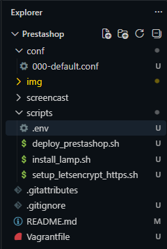

4. Editamos el archivo **`conf/000-default.conf`**, de manera que permitiremos la reescritura de **URLs (`.htaccess`)** que necesita **PrestaShop** en el directorio **`/var/www/html`**. Para ello, pegaremos el siguiente código:

```apache
<VirtualHost *:80>
    ServerAdmin webmaster@localhost
    DocumentRoot /var/www/html

    <Directory /var/www/html/>
        Options Indexes FollowSymLinks
        AllowOverride All
        Require all granted
    </Directory>

    ErrorLog ${APACHE_LOG_DIR}/error.log
    CustomLog ${APACHE_LOG_DIR}/access.log combined
</VirtualHost>
```

> **EXPLICACIÓN DEL CÓDIGO**
> ---
> Para el código anterior, debemos saber la función de las siguientes líneas:
>
> - **`<VirtualHost *:80>`**: Indica que este sitio web escuchará todas las peticiones que lleguen al servidor por el puerto **`80` (HTTP)**.
>
> - **`DocumentRoot /var/www/html`**: Define la carpeta raíz donde se alojan los archivos de la página web (donde instalaremos **PrestaShop**).
>
> - **`<Directory /var/www/html/>`**: Bloque que aplica reglas de seguridad y permisos específicos sobre el directorio de nuestra tienda:
>
>   - **`Options Indexes FollowSymLinks`**: Permite a **Apache** seguir enlaces simbólicos dentro de la carpeta.
>
>   - **`AllowOverride All`**: Permite que el archivo **`.htaccess`** de PrestaShop tome el control para reescribir las direcciones web y generar **URLs amigables**, ya que por defecto **Apache** trae **`AllowOverride None`** (ignora **`.htaccess`**).
>
>   - **`Require all granted`**: Autoriza el **acceso público** de cualquier usuario (navegador) al contenido web de ese directorio.
>
> - **`ErrorLog` y `CustomLog`**: Definen los archivos donde **Apache** guardará el registro de errores (**`error.log`**) y el historial de visitas (**`access.log`**).

Quedando el código de la siguiente manera:

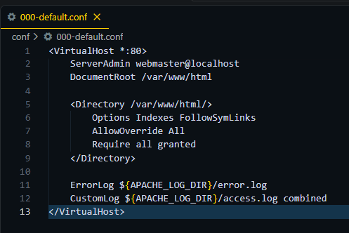

5. Seguidamente, editamos el **Vagrantfile** para levantar nuestra máquina con **Ubuntu Server** (asignando **2GB de RAM** y reenviando los puertos **`80`** y **`443`**):

> **Recordatorio**: El nombre de la máquina es elegible (en mi caso **`AmparoPrestashop`**).

```ruby
Vagrant.configure("2") do |config|
  # Imagen base: Ubuntu Server 22.04 LTS (Jammy)
  config.vm.box = "ubuntu/jammy64"
  config.vm.hostname = "UsuarioPrestashop"
  config.vm.boot_timeout = 600

  # Red privada y reenvio de puertos (HTTP y HTTPS)
  config.vm.network "private_network", ip: "192.168.56.10"
  config.vm.network "forwarded_port", guest: 80, host: 8080, auto_correct: true
  config.vm.network "forwarded_port", guest: 443, host: 8443, auto_correct: true

  # Configuracion de VirtualBox
  config.vm.provider "virtualbox" do |vb|
    vb.gui = true
    vb.name = "UsuarioPrestashop"
    vb.memory = "2048"
    vb.cpus = 1
    vb.customize ["modifyvm", :id, "--cableconnected1", "on"]
    vb.customize ["modifyvm", :id, "--uart1", "off"]
  end

  # Aprovisionamiento automatico con los scripts de Bash
  config.vm.provision "shell", path: "scripts/install_lamp.sh"
  config.vm.provision "shell", path: "scripts/setup_letsencrypt_https.sh"
  config.vm.provision "shell", path: "scripts/deploy_prestashop.sh"
end
```

> **EXPLICACIÓN DEL CÓDIGO**
> ---
> Para el código anterior, debemos saber la función de las siguientes líneas:
>
> - **`vb.memory = 2048`**: Asigna la **memoria RAM (`2GB`)** a la máquina.
>
> - **`forwarded_port` (`8080` y `8443`)**: Conectan los puertos **`80` (HTTP)** y **`443` (HTTPS)** de la máquina al navegador local para acceder a la tienda.
>
> - **`config.vm.provision`**: Automatiza la ejecución en orden de los tres **script Bash** (**LAMP, HTTPS y despliegue de PrestaShop**)


Quedando de la siguiente manera:

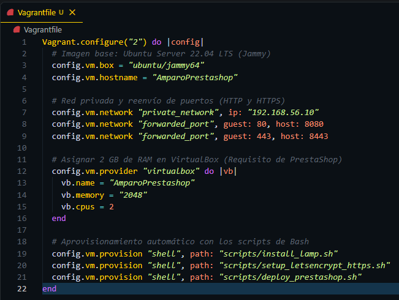

6. Y por último, configuramos el **`.env`** pegando el siguiente bloque de código:

> **Nota**: Establecer el nombre de usuario y la contraseña.

```bash
# Variables de configuracion de PrestaShop
CERTIFICATE_EMAIL="usuario@ejemplo.com"
CERTIFICATE_DOMAIN="usuarioprestashop.ddns.net"
DB_USER="prestashop_user"
DB_PASSWORD="prestashop_password"
DB_NAME="prestashop_db"
PS_DOMAIN="localhost:8443"
PS_EMAIL="admin@usuario.com"
PS_PASS="UsuarioAdmin123!"
PS_LANGUAGE="es"
PS_COUNTRY="es"
```

> **EXPLICACIÓN DEL CÓDIGO**
> ---
> - **Variables `CERTIFICATE_...`**: Definen el correo y el dominio que leerá el script de configuración HTTPS para generar el certificado SSL.
>
> - **Variables `DB_...`**: Contienen el nombre de la base de datos, el usuario y la contraseña. El script de la **pila LAMP** utilizará estos datos para crear la base de datos en **MariaDB** y asignarle los permisos necesarios automáticamente.
>
> - **Variables `PS_...`**: Almacenan las credenciales y los ajustes básicos de la tienda. El **CLI** de **PrestaShop** las utilizará para definir el dominio de la web (**`PS_DOMAIN`**), crear la cuenta de administrador para acceder al **Back-Office** (**`PS_EMAIL`** y **`PS_PASS`**) y establecer el idioma y país por defecto.

Quedando de la siguiente manera:

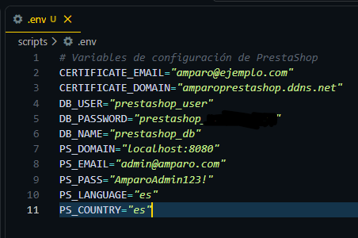

---

## **_2. Scripts de aprovisionamiento_**

Pasamos al punto 2, donde configuraremos los tres **scripts Bash** que **Vagrant** ejecutará para la automatización de toda la instalación de la tienda.

### **_2.1 Instalación de la pila LAMP y PHP_**

Editaremos el archivo **`install_lamp.sh`** para instalar **Apache**, **MariaDB** y **PHP** (según las directivas y extensiones de **PrestaShop**):

```bash
#!/bin/bash
set -ex

# Limpiar posibles saltos de linea de Windows (CRLF) en .env y conf
sed -i 's/\r$//' /vagrant/scripts/.env
sed -i 's/\r$//' /vagrant/conf/000-default.conf

# 1. Cargar las variables de entorno
source /vagrant/scripts/.env

# 2. Actualizar repositorios e instalar Apache y MariaDB
export DEBIAN_FRONTEND=noninteractive
apt-get update
apt-get install -y apache2 mariadb-server

# 3. Instalar PHP y las extensiones requeridas por PrestaShop
apt-get install -y php libapache2-mod-php php-mysql php-xml php-gd php-intl php-mbstring php-curl php-zip php-bcmath

# 4. Configurar las directivas de php.ini exigidas por PrestaShop (Apache y CLI)
for INI_FILE in /etc/php/8.1/apache2/php.ini /etc/php/8.1/cli/php.ini; do
    sed -i "s/;*memory_limit = .*/memory_limit = 256M/" "$INI_FILE"
    sed -i "s/;*max_input_vars = .*/max_input_vars = 5000/" "$INI_FILE"
    sed -i "s/;*post_max_size = .*/post_max_size = 128M/" "$INI_FILE"
    sed -i "s/;*upload_max_filesize = .*/upload_max_filesize = 128M/" "$INI_FILE"
done

# 5. Crear la base de datos y el usuario para PrestaShop
mysql -u root -e "DROP DATABASE IF EXISTS $DB_NAME;"
mysql -u root -e "CREATE DATABASE $DB_NAME CHARACTER SET utf8mb4 COLLATE utf8mb4_unicode_ci;"
mysql -u root -e "CREATE USER IF NOT EXISTS '$DB_USER'@'localhost' IDENTIFIED BY '$DB_PASSWORD';"
mysql -u root -e "GRANT ALL PRIVILEGES ON $DB_NAME.* TO '$DB_USER'@'localhost';"
mysql -u root -e "FLUSH PRIVILEGES;"

# 6. Copiar la configuracion del VirtualHost y habilitar mod_rewrite y headers
cp /vagrant/conf/000-default.conf /etc/apache2/sites-available/000-default.conf
sed -i '/<Directory \/var\/www\/>/,/<\/Directory>/ s/AllowOverride None/AllowOverride All/' /etc/apache2/apache2.conf
a2enmod rewrite
a2enmod headers
systemctl restart apache2
```

> **EXPLICACIÓN DEL CÓDIGO**
> ---
> Para el código anterior, debemos saber la función de las siguientes líneas:
>
> - **`source /vagrant/scripts/.env`**: Carga en memoria las variables del archivo **`.env`**.
>
> - **Extensiones de PHP**: Instalamos paquetes imprescindibles para **PrestaShop** (**`php-intl`**, **`php-gd`** o **`php-zip`**) que le permiten gestionar traducciones, procesar imágenes del catálogo y descomprimir módulos.
>
> - **`sed -i` (ajustes de `php.ini`)**: Usamos el comando **`sed`** para aumentar los recursos de **PHP**: subimos la memoria límite a **`256M`**, el número de variables de entrada a **`5000`** y el tamaño máximo de archivos a **`128M`** (según requisitos de **PrestaShop**).
>
> - **Creación de la Base de Datos**: Mediante comandos de **MySQL**, automatizamos la creación de la base de datos y le damos todos los permisos al usuario configurado en las variables.
>
> - **`cp`, `sed` y `a2enmod rewrite`**: Copiamos el **VirtualHost**, habilitamos `AllowOverride All` en `apache2.conf` (para que tenga efecto también en **HTTPS**) y activamos el módulo `rewrite` de **Apache** para procesar el archivo **`.htaccess`**.

Quedando de la siguiente manera:

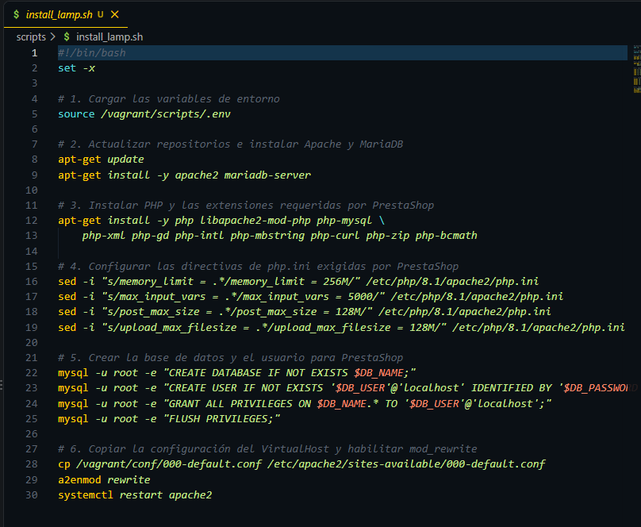

### **_2.2 Configuración del certificado SSL/HTTPS_**

Editaremos el archivo **`setup_letsencrypt_https.sh`** para asegurar el acceso web, generando un **certificado autofirmado** con **OpenSSL**:

```bash
#!/bin/bash
set -ex

source /vagrant/scripts/.env

# 1. Instalar Certbot y OpenSSL
export DEBIAN_FRONTEND=noninteractive
apt-get install -y certbot python3-certbot-apache openssl
a2enmod ssl

# 2. Generar certificado SSL autofirmado para el entorno local
mkdir -p /etc/apache2/ssl
openssl req -x509 -nodes -days 365 -newkey rsa:2048 \
  -keyout /etc/apache2/ssl/prestashop.key \
  -out /etc/apache2/ssl/prestashop.crt \
  -subj "/C=ES/ST=Badajoz/L=Merida/O=IES/OU=ASIR/CN=$CERTIFICATE_DOMAIN"

# 3. Configurar Apache para usar el certificado autofirmado
sed -i 's|/etc/ssl/certs/ssl-cert-snakeoil.pem|/etc/apache2/ssl/prestashop.crt|g' /etc/apache2/sites-available/default-ssl.conf
sed -i 's|/etc/ssl/private/ssl-cert-snakeoil.key|/etc/apache2/ssl/prestashop.key|g' /etc/apache2/sites-available/default-ssl.conf

# 4. Habilitar el sitio HTTPS y reiniciar
a2ensite default-ssl.conf
systemctl restart apache2

# (Opcional) Comando real para produccion con dominio publico:
# certbot --apache -m $CERTIFICATE_EMAIL --agree-tos --no-eff-email -d $CERTIFICATE_DOMAIN --non-interactive
```

> **EXPLICACIÓN DEL CÓDIGO**
> ---
> Para el código anterior, debemos saber la función de las siguientes líneas:
>
> - **`a2enmod ssl`**: Habilita el módulo de seguridad **SSL** en **Apache** para permitir conexiones **HTTPS**.
>
> - **`openssl req ...`** Al estar en una máquina virtual local sin **IP pública**, **Certbot** no puede validar el dominio real. Por ello, generamos un **certificado autofirmado** con **OpenSSL** válido (por 365 días), indicando la ruta donde se guardarán la clave (**`.key`**) y el certificado (**`.crt`**).
>
> - **`sed -i`** en **`default-ssl.conf`**: Cambiamos las rutas de los certificados genéricos que trae **Apache** por defecto por las rutas de los certificados generados con **OpenSSL**
>
> - **Comando real de Certbot** (comentado al final como **`certbot --apache...`**): Se ejecutaría de forma desatendida (**`--non-interactive`**) en caso de que la máquina estuviera expuesta a **Internet**.

Quedando el código así:

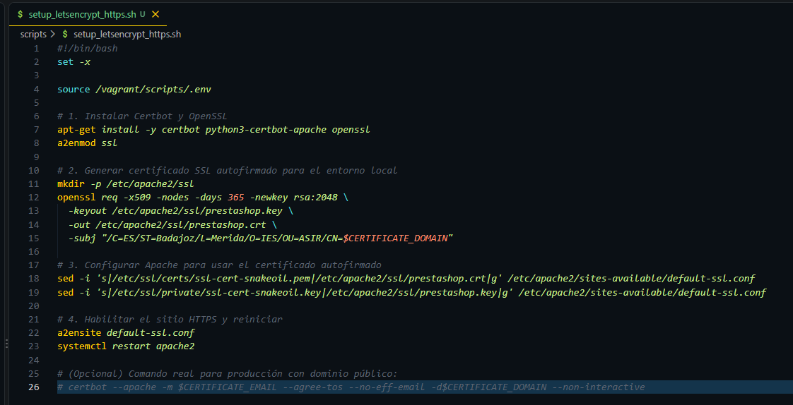

### **_2.3 Despliegue de PrestaShop (CLI) y PhpPsInfo_**

Por último, editamos el script **`deploy_prestashop.sh`** para descargar la herramienta de comprobación **PhpPsInfo** y automatizar la instalación de la tienda desde la consola (**CLI**):

> **Recordatorio**: Cambiar el usuario y apellido a los que se les haya puesto anteriormente.

```bash
#!/bin/bash
set -ex

source /vagrant/scripts/.env

# 1. Limpiar /var/www/html y descargar script de comprobacion PhpPsInfo
rm -rf /var/www/html/* /var/www/html/.* 2>/dev/null || true
wget -q https://raw.githubusercontent.com/PrestaShop/php-ps-info/master/phppsinfo.php -O /var/www/html/phppsinfo.php

# 2. Descargar y descomprimir PrestaShop en modo silencioso (-oq)
export DEBIAN_FRONTEND=noninteractive
apt-get install -y unzip
wget -q https://github.com/PrestaShop/PrestaShop/releases/download/8.1.2/prestashop_8.1.2.zip -O /tmp/prestashop.zip
unzip -oq /tmp/prestashop.zip -d /var/www/html/
unzip -oq /var/www/html/prestashop.zip -d /var/www/html/
rm -f /var/www/html/prestashop.zip /tmp/prestashop.zip /var/www/html/index.html

# 3. Asignar permisos al usuario de Apache
chown -R www-data:www-data /var/www/html/
chmod -R 755 /var/www/html/

# 4. Instalacion automatizada por CLI (con SSL activado)
cd /var/www/html/install
sudo -u www-data php index_cli.php \
  --domain="$PS_DOMAIN" \
  --ssl=1 \
  --db_server="127.0.0.1" \
  --db_name="$DB_NAME" \
  --db_user="$DB_USER" \
  --db_password="$DB_PASSWORD" \
  --firstname="Usuario" \
  --lastname="Apellido" \
  --password="$PS_PASS" \
  --email="$PS_EMAIL" \
  --language="$PS_LANGUAGE" \
  --country="$PS_COUNTRY"

# 5. Borrar carpeta install, renombrar admin y limpiar cache/permisos
rm -rf /var/www/html/install
mv /var/www/html/admin /var/www/html/admin_usuario
rm -rf /var/www/html/var/cache/*
chown -R www-data:www-data /var/www/html/
systemctl restart apache2
```

> **EXPLICACIÓN DEL CÓDIGO**
> ---
> Para el código anterior, debemos saber la función de las siguientes líneas:
>
> - **`phppsinfo.php`**: Descargamos mediante **`wget`** este script (proporcionado por **PrestaShop**) para poder comprobar gráficamente que el servidor cumple todos los requisitos de configuración y extensiones **PHP** antes de iniciar la instalación.
>
> - **`unzip -oq`**: Descomprime el paquete dos veces usando los parámetros **`-o`** (sobreescribir archivos sin pedir confirmación) y **`-q`** (modo silencioso para no saturar la terminal). Después, borramos los archivos `.zip` sobrantes y el `index.html` por defecto.
>
> - **`chown -R www-data:www-data`**: Cambiamos el propietario de todos los archivos web al usuario de **Apache (`www-data`)** para que la tienda tenga permisos de lectura y escritura.
>
> - **Instalación CLI (`index_cli.php`)**: Ejecutamos el instalador por terminal de **PrestaShop**, activando el soporte HTTPS (**`--ssl=1`**) y pasándole como parámetros (**`--domain`**, **`--db_name`**, **`--email`**...) todas las variables del archivo **`.env`**.
>
> - **`rm -rf` y `mv`**: Una vez finalizada la instalación, **PrestaShop** obliga por seguridad a eliminar la carpeta **`install`** y a renombrar la carpeta **`admin`** (en mi caso a **`admin_usuario`**); si no se hace, bloquea el acceso al panel de administración.

El código queda de la siguiente manera:

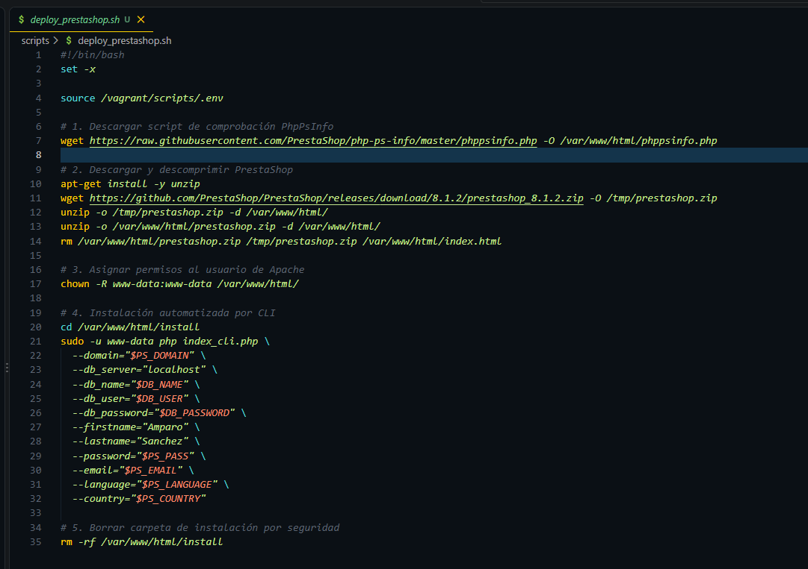

---

## **_3. Comprobación del funcionamiento_**

Ahora, realizaremos las siguientes pruebas para comprobar que todo funciona correctamente.

### **_3.1 PhpPsInfo_**

Entramos en **`https://localhost:8443/phppsinfo.php`**, donde veremos una pantalla con tablas detallando la versión de **PHP**, extensiones y permisos de directorios:

> **Nota**: Pedirá usuario y contraseña por defecto (**`prestashop`**), así que los escribimos e iniciamos sesión.

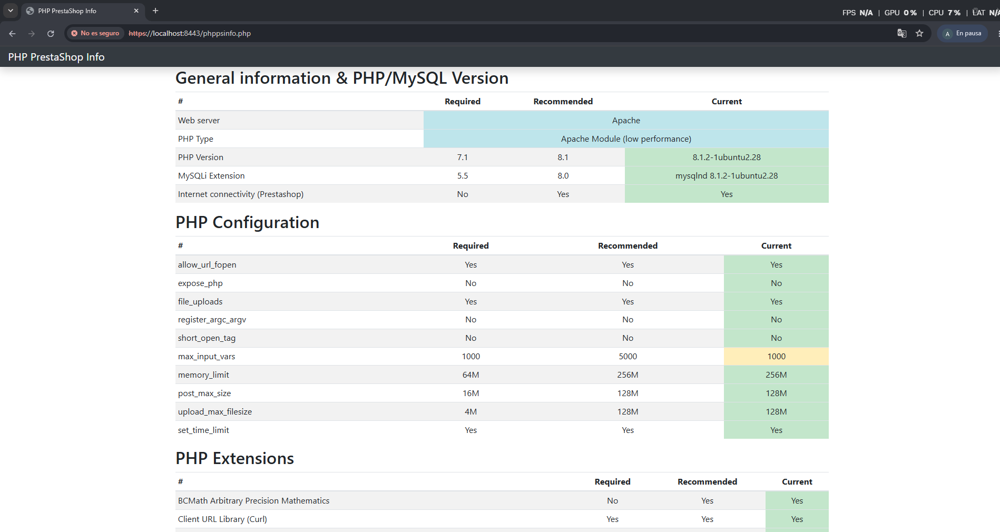

### **_3.2 Front-Office_**

Accedemos a **`https://localhost:8443`** y veremos la portada de la tienda instalada y el candado **HTTPS** en la barra de direcciones:

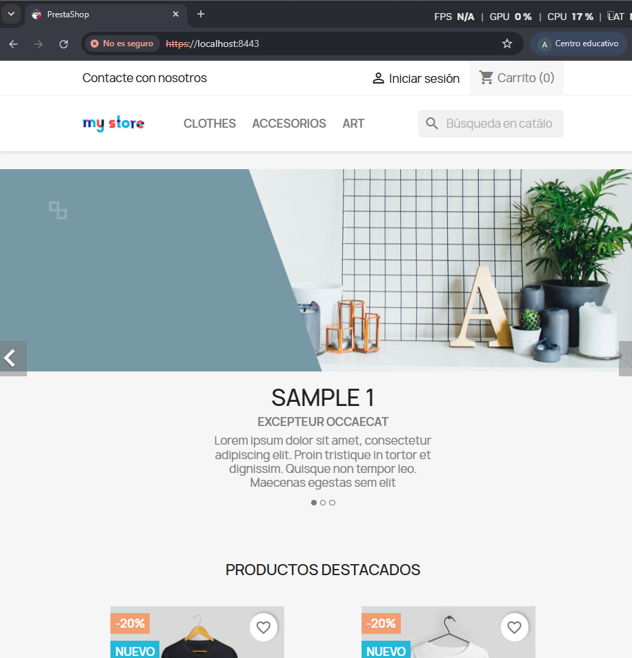

### **_3.3 Back-Office_**

Entramos en la máquina usando **`vagrant ssh`** y hacemos un **`ls /var/www/html`** para comprobar que la carpeta `install` se ha eliminado y que la carpeta de administración se ha renombrado correctamente a **`admin_usuario`**.

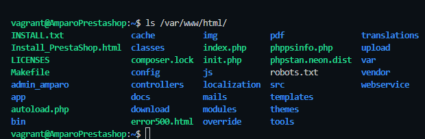

Seguidamente, vamos al navegador y buscamos **`https://localhost:8443/admin_usuario`** e iniciamos sesión con el correo y contraseña del **`.env`**:

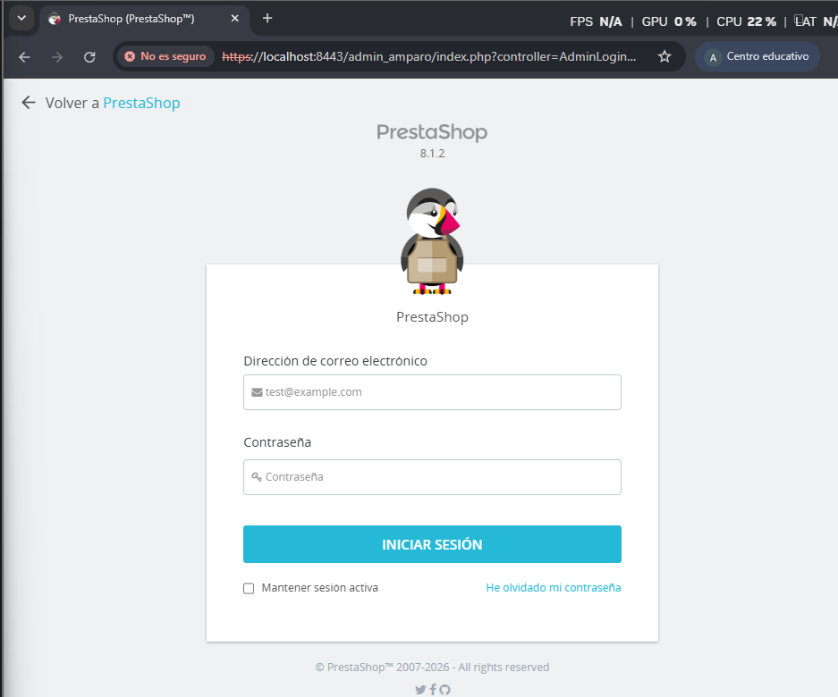

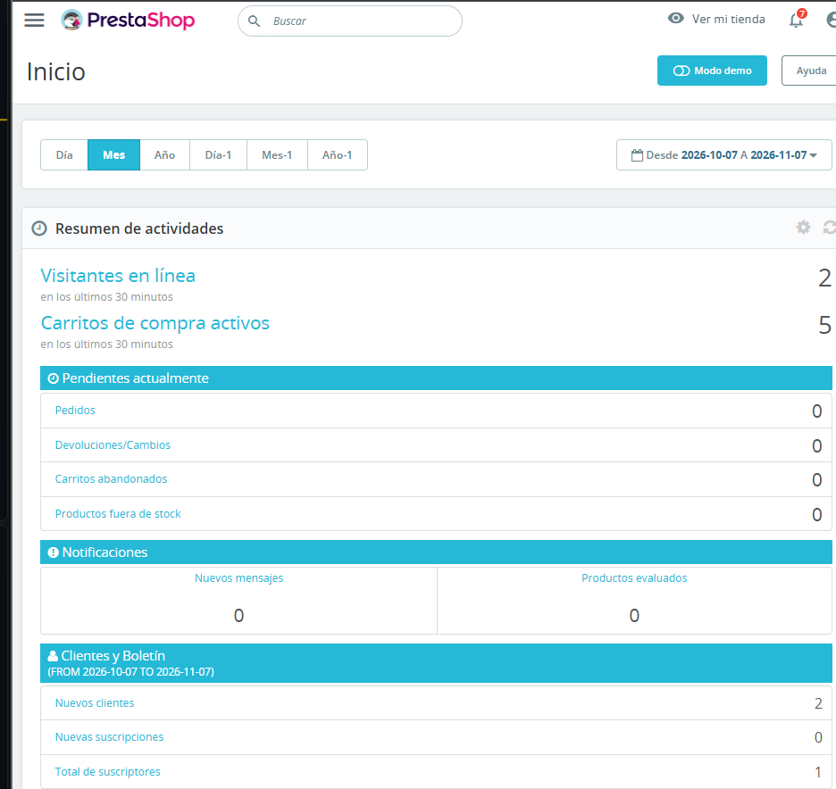

---

## **_Screencast_**

[Screencast Funcionamiento](screencast/Prestashop_funcionamiento.mp4)

---

## **_Incidencias_**

### **_Incidencia 1_**

Durante la ejecución del comando **`vagrant up`**, la máquina superaba el tiempo de espera (**`config.vm.boot_timeout`**).

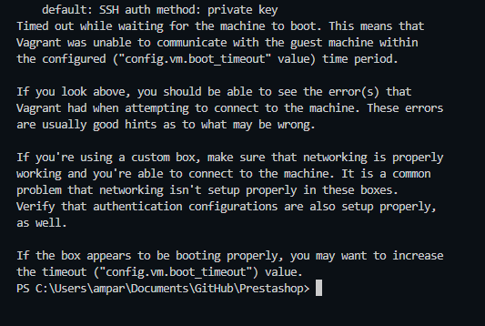

> **Causa**: Esto se debe a un fallo de **ubuntu/jammy64** con el puerto serie (**`uart1`**) y la gestión multiprocesador de **VirtualBox** en Windows.

> **Solución**: Ajustamos la configuración del proveedor en el **Vagrantfile**:
> - **`vb.cpus = 1`**
> - desactivando **`--uart1 off`**
> - forzando la conexión del adaptador con **`--cableconnected1 on`**

### **_Incidencia 2_**

Al intentar acceder a **`https://localhost:8443`**, devolvía el mensaje de **"Error 500"**.

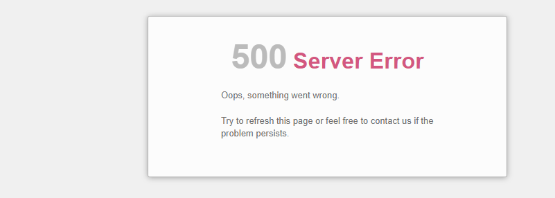

> **Causa**: Ocurría ya que al crear los scripts de aprovisionamiento y el fichero **`.env`**, se insertaban caracteres de retorno de carro ocultos (**`\r`**), provocando el error.

> **Solución**: Se ha solucionado automatizando la conversión y limpieza del formato al inicio del script **`install_lamp.sh`** usando el comando **`sed -i 's/\r$//'`** sobre los archivos afectados.

---

## **_Fuentes consultadas_**

- **[Documentación oficial de PrestaShop](https://devdocs.prestashop-project.org/8/basics/installation/install-from-cli/)**

- **[Requisitos del sistema de PrestaShop](https://devdocs.prestashop-project.org/8/basics/installation/system-requirements/)**

- **[Repositorio oficial de PhpPsInfo en GitHub](https://github.com/PrestaShop/php-ps-info)**

- **[Documentación oficial de Vagrant](https://developer.hashicorp.com/vagrant/docs)**